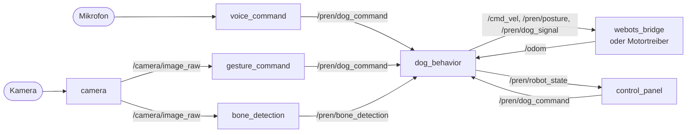
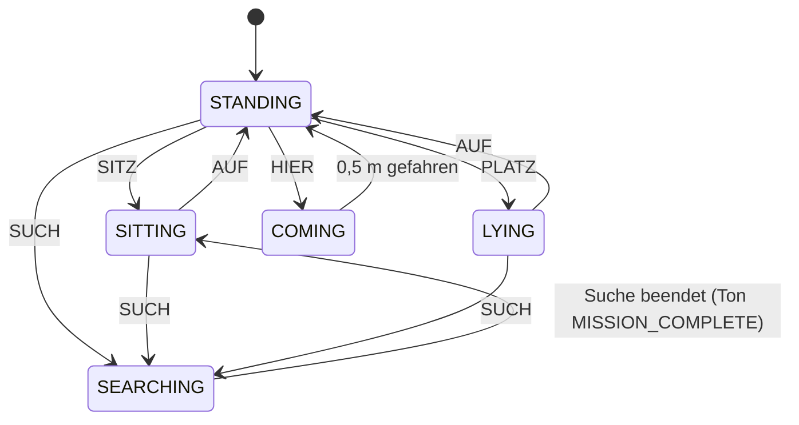

# ROS-2-Architektur des Roboterhunds

Stand: 25.11.2026. Dieses Dokument beschreibt die ROS-2-Pakete unter `workspace/src`. Der frühere Ablauf mit UDP und `such_driver` (Paket `pren_control`, `simulation_prototype.launch.py`) wurde am 25.11.2026 entfernt; er ist nur noch historisch in [INTERFACES.md](INTERFACES.md) beschrieben.

## Überblick



In der Simulation liefert `webots_bridge` `/odom` und `/pren/bone_detection` (simulierter Sichtkegel). Auf dem Roboter übernehmen Motortreiber und `bone_detection` diese Rolle. Alle anderen Nodes bleiben gleich.

## Pakete

| Paket | Inhalt |
| --- | --- |
| `pren_interfaces` | Messages: `DogCommand`, `BoneDetection`, `Posture`, `DogSignal`, `RobotState` |
| `pren_behavior` | `dog_behavior_node` mit `DogStateMachine` (Befehle), `SearchMission` (SUCH), `ComeHereManeuver` (HIER) |
| `pren_perception` | `camera_node`, `voice_command_node`, `gesture_command_node`, `bone_detection_node` |
| `pren_simulation` | Webots-Bridge (gestartet über `simulation/webots/controllers/pren_bridge`), `control_panel` |
| `pren_bringup` | Launch-Dateien, `config/*.yaml`, Suche nach Webots und Modellen |

## Aufbau eines Nodes

Jeder Node ist eine dünne Hülle: Parameter lesen, Topics verbinden, Messages umwandeln. Die eigentliche Logik liegt in reinen Python-Klassen ohne ROS, die mit `pytest` ohne Hardware getestet werden.

| Node | Logik-Klassen |
| --- | --- |
| `dog_behavior_node` | `DogStateMachine`, `SearchMission`, `ComeHereManeuver` |
| `voice_command_node` | `NoiseGate`, `find_command`, `RepeatFilter`, `VoiceCommandDetector` (+ `VoskRecognizer`, `Microphone`) |
| `gesture_command_node` | `classify_hand`, `GestureDebouncer`, `GestureCommandDetector` (+ `HandLandmarkDetector`) |
| `bone_detection_node` | `locate_bone` (+ `YoloBoneDetector`) |
| `webots_bridge` | `DifferentialDrive`, `VisionCone`, `DogAppearance` (+ `WebotsWorld`) |

## Topics

| Topic | Typ | Von | An |
| --- | --- | --- | --- |
| `/pren/dog_command` | `pren_interfaces/DogCommand` | voice, gesture, control_panel | dog_behavior |
| `/pren/bone_detection` | `pren_interfaces/BoneDetection` | bone_detection bzw. webots_bridge | dog_behavior, control_panel |
| `/pren/robot_state` | `pren_interfaces/RobotState` | dog_behavior (20 Hz) | control_panel, webots_bridge |
| `/pren/posture` | `pren_interfaces/Posture` (latched) | dog_behavior | webots_bridge / Beine |
| `/pren/dog_signal` | `pren_interfaces/DogSignal` | dog_behavior | webots_bridge / Lautsprecher |
| `/cmd_vel` | `geometry_msgs/Twist` | dog_behavior (20 Hz) | webots_bridge / Motortreiber |
| `/odom` | `nav_msgs/Odometry` | webots_bridge / Odometrie | dog_behavior |
| `/camera/image_raw` | `sensor_msgs/Image` | camera | gesture_command, bone_detection |
| `/pren/voice/level` | `std_msgs/Float32` | voice_command | Diagnose (Schwelle einstellen) |
| `/pren/reset` | `std_msgs/Empty` | control_panel, Skript | dog_behavior, webots_bridge |

## Verhalten

| Befehl | Erlaubte Quelle | Reaktion |
| --- | --- | --- |
| HIER | Sprache | 0,5 m auf die Person zu, dann stehen |
| BRAV | Sprache | Signal `PRAISE`, Zustand bleibt |
| SITZ | Sprache, Geste | Stopp, Haltung `SIT` |
| SUCH | Sprache | Drehen, Suchbereich absuchen, Knochen anfahren, bellen, zurück, zum Schiedsrichter drehen, dann sitzen mit Abschlusston (Anforderung 5.8) |
| PLATZ | Geste | Stopp, Haltung `LIE` |
| AUF | Geste | Haltung `STAND` |

Während SUCH läuft, werden alle Befehle ignoriert. Befehle aus einer nicht erlaubten Quelle werden ignoriert (`enforce_command_sources` in `config/behavior.yaml`). Das Bedienfenster darf alle Befehle senden.

### Zustände

`DogStateMachine` (Wert von `RobotState.state`):



SITZ, PLATZ, AUF und HIER sind aus jedem Zustand ausser SEARCHING möglich; BRAV sendet nur `PRAISE`. Reset führt immer zurück nach STANDING. In SEARCHING ist `busy` gesetzt und alle Befehle werden abgelehnt.

`SearchMission` (Wert von `RobotState.activity` während der Suche):

| Phase | Ende der Phase |
| --- | --- |
| Zum Suchbereich drehen | um 180° gedreht |
| Suchbereich absuchen | Knochen gesehen; nach 4,6 m ohne Fund zurück |
| Knochen anfahren | 3 Messungen in Folge ≤ 0,32 m → Signal `BARK`; Knochen > 1,5 s weg → weitersuchen |
| Knochen gefunden | 2,2 s |
| Zurück zum Startfeld fahren | ≤ 0,15 m am Start |
| Zum Schiedsrichter drehen | ausgerichtet → Signal `MISSION_COMPLETE`, Haltung `SIT`, Zustand SITTING |

Haltung `SIT` und Signal `MISSION_COMPLETE` kommen im selben Regelschritt und genau einmal. Danach sind wieder alle Befehle frei (z. B. AUF zum Aufstehen).

## Bauen, testen, starten

```powershell
pixi run build          # colcon build
pixi run test           # alle Unit-, Integrations- und Lint-Tests

# Simulation mit Sprache und Gesten
.\scripts\start_simulation.bat
# nur Simulation, Befehle über das Bedienfenster
cd workspace; . .\install\local_setup.ps1
ros2 launch pren_bringup simulation.launch.py voice:=false gesture:=false
# nur Wahrnehmung am Laptop (z. B. für T1/T2)
ros2 launch pren_bringup perception.launch.py
ros2 topic echo /pren/dog_command
```

### Abnahmetest der Simulation

`simulation_check` spielt alle Befehle ein und wiederholt SUCH mehrmals mit neu platziertem Knochen. Mit `webots_gui:=false` läuft Webots minimiert, mit eigenem Port und eigener ROS-Domain stört der Test keine laufende Simulation:

```powershell
cd workspace; . .\install\local_setup.ps1
$env:ROS_DOMAIN_ID = '87'
ros2 launch pren_bringup simulation.launch.py webots_gui:=false webots_port:=1240 voice:=false gesture:=false control_panel:=false
# zweites Terminal, ebenfalls mit ROS_DOMAIN_ID 87:
ros2 run pren_simulation simulation_check --ros-args -p search_runs:=5
```

## Stabilität

| Bereich | Massnahme | Geprüft durch |
| --- | --- | --- |
| Sprache | Befehl nur, wenn die ganze Äusserung genau ein Befehlswort ist (Sicherheit ≥ 0,7, höchstens 2 s). Füllwörter in der Vosk-Wortliste fangen andere Wörter ab. | 40 Testaufnahmen unter `pren_perception/test/data/voice` (Befehle, Einzelwörter, Sätze, mit und ohne Rauschen) |
| Gesten | Mehrheitsentscheid über 5 Bilder, Sperrzeit 1 s | Zittern, Handgrösse, Position, linke Hand, flackernde Erkennung |
| Suche | Kontakt erst nach 3 Messungen in Folge, Weitersuchen bei verlorenem Knochen, Rückkehr ohne Fund | 80 Zufallsläufe mit und ohne Kamerarauschen, Sektorränder |
| Sensorausfall | Ohne Odometrie (> 0,5 s) hält der Hund an; alte Knochenmeldungen (> 0,5 s) werden verworfen | Integrationstest mit abbrechender Odometrie |
| Simulation | Webots startet ohne Pixi-Umgebung (sonst Absturz 0xC0000374) | `simulation_check` |

## Modelle

Die Launch-Dateien und Testskripte suchen die Modelle unter `models/`. Die Modelle sind
nicht versioniert; Download-Quelle und Ablage stehen in der README des jeweiligen Ordners.

| Modell | Ort |
| --- | --- |
| Vosk `vosk-model-small-de-0.15` | `models/voice/` |
| MediaPipe `hand_landmarker.task` | `models/gesture/` |
| YOLO Knochen | `models/bone_detection/` (noch nicht trainiert) |

## Offene Punkte

1. **Sprache mit echten Stimmen abstimmen.** Die Testaufnahmen stammen von der Windows-Stimme. `min_confidence` und `max_utterance_s` mit den T1-Messungen (verschiedene Personen, 60 dB) prüfen.
2. **Picamera2-Backend** für `camera_node` auf dem Pi 5.
3. **YOLO-Modell** trainieren und `bone_detection_node` mit `ultralytics` (bzw. NCNN) in die Umgebung aufnehmen.
4. **Motortreiber-Node** für den echten Roboter (`/cmd_vel`, `/pren/posture` → Hardware, `/odom` zurück).
