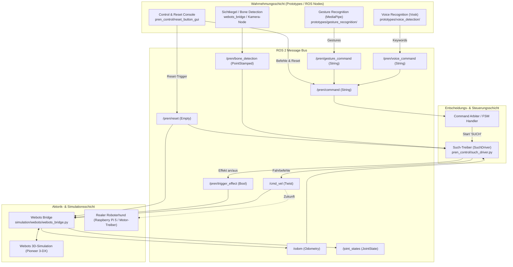

# Schnittstellenspezifikation & Integrationsleitfaden: PREN Roboterhund (Gruppe 17)

Dieses Dokument spezifiziert alle software- und hardwareseitigen Schnittstellen des PREN-Roboterhundes. Es dient als verbindliche Referenz, um die bestehenden Prototypen für **Voice Detection** und **Gesture Recognition** nahtlos in die ROS-2-Gesamtarchitektur und die Webots-Simulation einzubinden.

---

## 1. Gesamtsystem-Architektur

Die Softwarearchitektur folgt einer dreistufigen Schichten-Trennung (Wahrnehmung $\rightarrow$ Steuerung $\rightarrow$ Aktorik/Simulation):



---

## 2. ROS-2-Schnittstellenmatrix (Topics & Formate)

| Topic | Nachrichtentyp | Richtung | Frequenz / Trigger | Beschreibung & Payload |
| :--- | :--- | :--- | :--- | :--- |
| **`/pren/command`** | `std_msgs/msg/String` | Perception $\rightarrow$ Control | Event-basiert | **Zentraler Steuerkanal.** Gültige Strings: `"SUCH"`, `"HIER"`, `"SITZ"`, `"PLATZ"`, `"AUF"`, `"BRAV"`, `"STOP"`. |
| **`/pren/voice_command`** | `std_msgs/msg/String` | Voice $\rightarrow$ Perception | Event-basiert | Rohausgabe des Vosk-Erkenners (`"such"`, `"sitz"`, `"platz"`, `"auf"`, `"hier"`, `"brav"`). |
| **`/pren/gesture_command`**| `std_msgs/msg/String` | Gesture $\rightarrow$ Perception | Event-basiert | Rohausgabe von MediaPipe (`"UP"`, `"DOWN"`, `"SIT"`). |
| **`/pren/reset`** | `std_msgs/msg/Empty` | GUI/User $\rightarrow$ Sim & Control | Event-basiert | **Setup-Reset:** Teleportiert Roboter zum Startfeld $(0,0)$, platziert Knochen neu, stoppt Audio & Motoren. |
| **`/pren/reset_done`** | `std_msgs/msg/Empty` | Bridge $\rightarrow$ Control | Event-basiert | Bestätigung der Simulation, dass Pose und Welt neu aufgesetzt wurden. |
| **`/pren/bone_detection`**| `geometry_msgs/msg/PointStamped` | Bridge $\rightarrow$ SuchDriver | $20\,\text{Hz}$ | **Sichtkegel-Sensor:** `point.x` = Distanz $[m]$, `point.y` = Relativwinkel $[\text{rad}]$, `point.z` = $1.0$ (erkannt) / $0.0$ (nicht erkannt). |
| **`/pren/trigger_effect`**| `std_msgs/msg/Bool` | SuchDriver $\rightarrow$ Bridge | Flankengesteuert | `True` beim Auffinden des Knochens (löst Bellen und Licht aus); `False` nach Fundquittung (schaltet Audio & Licht aus). |
| **`/pren/final_signal`** | `std_msgs/msg/Bool` | SuchDriver $\rightarrow$ Bridge | Einmalig bei Zielankunft | `True`, wenn Roboter im Startfeld in Endposition steht (spielt Quittungston). |
| **`/pren/search_status`** | `std_msgs/msg/String` | SuchDriver $\rightarrow$ UI | Bei Phasenwechsel | Aktueller Zustand der FSM (`"Suchbereich scannen"`, `"Knochen erreicht"`, etc.). |
| **`/pren/robot_state`** | `std_msgs/msg/String` | SuchDriver $\rightarrow$ UI/Prozesse | $20\,\text{Hz}$ / Event | **Zentralisierter Systemstatus (JSON):** `{"state": ..., "busy": bool, "robot_x": ..., "robot_y": ..., "bone_detected": bool, "last_command": ...}`. |
| **`/cmd_vel`** | `geometry_msgs/msg/Twist` | Control $\rightarrow$ Bridge/Hardware | $10 - 20\,\text{Hz}$ | `linear.x` $[m/s]$ (Vorwärts), `angular.z` $[\text{rad}/s]$ (Gierdrehung). |
| **`/odom`** | `nav_msgs/msg/Odometry` | Bridge/Hardware $\rightarrow$ Control | $20\,\text{Hz}$ | Roboterposition $(x, y)$, Orientierungs-Quaternion ($q_z, q_w$) und Geschwindigkeiten. |
| **`/joint_states`** | `sensor_msgs/msg/JointState` | Bridge/Hardware $\rightarrow$ Control | $20\,\text{Hz}$ | Encoder-Radpositionen in Radiant (`left_wheel_joint`, `right_wheel_joint`). |

---

### 2.1 Inter-Prozess UDP-Schnittstellen (Cross-Venv Synchronisation)

Da Voice- und Gestenerkennung in isolierten Python-3.11-Environments laufen, erfolgt die bidirektionale Kopplung über performante UDP-Sockets auf Localhost (`127.0.0.1`):

| Port | Richtung | Sender $\rightarrow$ Empfänger | Inhalt & Zweck |
| :--- | :--- | :--- | :--- |
| **`9876`** | Eingehend | Voice / Geste $\rightarrow$ `such_driver.py` | String-Kommandos (`"SUCH"`, `"SITZ"`, `"PLATZ"`, etc.) |
| **`9878`** | Ausgehend | `such_driver.py` $\rightarrow$ Voice Control | Roboter-Zustand (JSON); setzt Vosk-Deduplizierung bei `IDLE` zurück |
| **`9879`** | Ausgehend | `such_driver.py` $\rightarrow$ Gestensteuerung | Roboter-Zustand (JSON); steuert HUD-Anzeige und Sperre für Gesten |

---

## 3. Integration des Voice-Detection-Prototyps

### 3.1 Übersicht
Der Prototyp unter [`prototypes/voice_detection/`](file:///c:/Users/Oliver/Documents/Roboterhund-Gruppe17/prototypes/voice_detection/) verwendet das kompakte deutsche Modell **Vosk** für Offline-Erkennung mit Rauschfilter (RMS-Threshold) und De-Duplication.

### 3.2 Befehls-Mapping

| Gesprochenes Wort | Ausgabe in `VoiceDetector` | Ziel-Kommando auf `/pren/command` | Roboter-Reaktion gemäss HSLU-Vorgabe |
| :--- | :--- | :--- | :--- |
| **«SUCH»** | `"such"` | `"SUCH"` | Roboter dreht sich in das $30^\circ$-Segment und startet autonomen Suchlauf. |
| **«HIER»** | `"hier"` | `"HIER"` | Erkennbare Vorwärtsbewegung auf die Person zu ($v > 0$). |
| **«SITZ»** | `"sitz"` | `"SITZ"` | Roboter stoppt sofort und signalisiert Sitzhaltung. |
| **«PLATZ»** | `"platz"` | `"PLATZ"` | Roboter legt sich hin (stoppt Fahrantrieb). |
| **«AUF»** | `"auf"` | `"AUF"` | Roboter steht auf / wechselt in Grundstellung. |
| **«BRAV»** | `"brav"` | `"BRAV"` | Emotionale Reaktion (akustische/motorische Bestätigung). |

### 3.3 Bereitgestellter ROS-2-Wrapper (`voice_bridge_node.py`)

Um `voice_control.py` ohne Code-Umbau direkt als ROS-2-Node zu betreiben, wird folgender Wrapper in `workspace/src/pren_perception/` eingebunden:

```python
import rclpy
from rclpy.node import Node
from std_msgs.msg import String

# Import aus dem bestehenden Prototyp
import sys
from pathlib import Path
sys.path.append(str(Path(__file__).resolve().parents[4] / "prototypes" / "voice_detection"))
from voice_control import VoiceDetector, CONFIG

class VoiceBridgeNode(Node):
    def __init__(self):
        super().__init__("voice_bridge_node")
        self.cmd_pub = self.create_publisher(String, "/pren/command", 10)
        self.raw_voice_pub = self.create_publisher(String, "/pren/voice_command", 10)

        # Callback an VoiceDetector uebergeben
        self.detector = VoiceDetector(on_keyword_detected=self.on_keyword)
        self.detector.start()
        self.get_logger().info("VoiceBridgeNode gestartet. Hoere auf Befehle...")

    def on_keyword(self, keyword_token: str, display_name: str, rms_level: float):
        cmd_str = keyword_token.upper()
        self.get_logger().info(f"Sprachbefehl erkannt: '{cmd_str}' (RMS: {rms_level:.0f})")

        # Publizieren
        msg = String()
        msg.data = cmd_str
        self.cmd_pub.publish(msg)
        self.raw_voice_pub.publish(msg)

    def destroy_node(self):
        self.detector.stop()
        super().destroy_node()
```

---

## 4. Integration des Gesture-Recognition-Prototyps

### 4.1 Übersicht
Der Prototyp unter [`prototypes/gesture_recognition/`](file:///c:/Users/Oliver/Documents/Roboterhund-Gruppe17/prototypes/gesture_recognition/) nutzt **MediaPipe Hands** mit 21 3D-Hand-Landmarks, Glättungsfilter (Majority Vote) und Cooldown-Sperre.

### 4.2 Gesten-Mapping

| Geste | MediaPipe Klassifikation | Ziel-Kommando auf `/pren/command` | Roboter-Reaktion gemäss HSLU-Vorgabe |
| :--- | :--- | :--- | :--- |
| **Zeigefinger zeigt nach oben / «L»** | `"UP"` | `"AUF"` | Roboter steht auf / nimmt Grundhaltung ein. |
| **Zeigefinger zeigt zum Boden** | `"DOWN"` | `"PLATZ"` | Roboter legt sich hin. |
| **Flache Hand vor der Brust** | `"SIT"` | `"SITZ"` | Roboter setzt sich hin / stoppt Bewegung. |

### 4.3 Bereitgestellter ROS-2-Wrapper (`gesture_bridge_node.py`)

Folgender Wrapper bindet `gesture_classifier.py` als ROS-Node ein:

```python
import rclpy
from rclpy.node import Node
from std_msgs.msg import String

import sys
from pathlib import Path
sys.path.append(str(Path(__file__).resolve().parents[4] / "prototypes" / "gesture_recognition"))
from gesture_classifier import GestureClassifier, GestureSmoother

class GestureBridgeNode(Node):
    def __init__(self):
        super().__init__("gesture_bridge_node")
        self.cmd_pub = self.create_publisher(String, "/pren/command", 10)
        self.raw_gesture_pub = self.create_publisher(String, "/pren/gesture_command", 10)

        self.classifier = GestureClassifier()
        self.smoother = GestureSmoother(history_size=5, cooldown_seconds=1.0)
        self.get_logger().info("GestureBridgeNode initialisiert.")

    def process_landmarks(self, landmarks):
        gesture_enum, confidence = self.classifier.classify(landmarks)
        smoothed_gesture = self.smoother.update(gesture_enum)

        if smoothed_gesture is not None:
            # Mapping auf Deutsche Kommandos
            mapping = {"UP": "AUF", "DOWN": "PLATZ", "SIT": "SITZ"}
            cmd_name = mapping.get(smoothed_gesture.name, smoothed_gesture.name)

            self.get_logger().info(f"Geste erkannt: {cmd_name} (Konfidenz: {confidence:.2f})")
            msg = String(data=cmd_name)
            self.cmd_pub.publish(msg)
            self.raw_gesture_pub.publish(msg)
```

---

## 5. Reset- und Steuerkonsole

Die Simulation stellt drei Möglichkeiten bereit, um das Setup jederzeit zurückzusetzen:

1. **Grafische Reset-Konsole (GUI):**
   * Automatisch im Launchfile integriert oder über [`workspace/src/pren_control/pren_control/reset_button_gui.py`](file:///c:/Users/Oliver/Documents/Roboterhund-Gruppe17/workspace/src/pren_control/pren_control/reset_button_gui.py) ausführbar.
   * Grüner Button: **«🔄 Setup Neustarten / Reset»** $\rightarrow$ sendet `/pren/reset`.
   * Live-Anzeige von Roboter-Koordinaten, FSM-Phase und Sichtkegel-Status.
2. **Webots-Tastaturkürzel:**
   * Klick in das Webots 3D-Fenster und Drücken der Taste **`R`** setzt Roboter, Knochen und Audio sofort zurück.
3. **Skript & CLI:**
   * Doppelklick auf [`scripts/reset_simulation.bat`](file:///c:/Users/Oliver/Documents/Roboterhund-Gruppe17/scripts/reset_simulation.bat).
   * Oder im Terminal: `ros2 topic pub --once /pren/reset std_msgs/msg/Empty "{}"`.

---

## 6. Audio-Schnittstelle & Saubere Abschaltung

1. **Knochen-Fund:**
   * Beim Übergang in den Zustand `CELEBRATE` wird genau **ein** Signal auf `/pren/trigger_effect` (`True`) gesendet.
   * `webots_bridge.py` spielt den Bell-Ton (`dog_bark.wav`) genau einmal ab und aktiviert das pulsierende Licht.
   * Nach $2.2\,\text{s}$ wird `/pren/trigger_effect` auf `False` gesetzt. Die Bridge stoppt sofort jegliche Audio-Threads (`winsound.SND_PURGE`), sodass **kein anhaltendes Bellen** auftritt.
2. **Mission Complete:**
   * Bei Ankunft im Startfeld publiziert `such_driver` auf `/pren/final_signal` (`True`), was den Abschluss-Gong (`victory_chime.wav`) auslöst.

---

## 7. Hardware-Mapping (Übertrag auf Raspberry Pi 5)

Auf der echten Hardware bleiben alle ROS-Topics identisch:

| Logische ROS-Schnittstelle | Simulation (Webots) | Realer Roboter (Raspberry Pi 5) |
| :--- | :--- | :--- |
| `/cmd_vel` | Differential-Drive-Rechnung in `webots_bridge.py` | Motortreiber via PWM / Serial / `ros2_control` |
| `/joint_states` | Simulierte Encoder `left/right wheel sensor` | Hall-Sensor / optische Encoder via GPIO |
| `/odom` | Supervisor Ground Truth & Encoder-Integration | Rad-Odometrie + IMU (z.B. BNO055 via I2C) |
| `/pren/command` | Virtuelle ROS-Nachrichten / GUI | Mikrofon (USB/I2S) via Vosk & Kamera (CSI) via MediaPipe |
| `/pren/bone_detection` | Mathematischer $45^\circ$-Sichtkegel via Supervisor | OpenCV / YOLO / ToF-Sensor Distanzmessung |
| `/pren/trigger_effect` | Webots `Speaker` & `PointLight` | Piezo-Buzzer / Lautsprecher (I2S) & Neopixel-LEDs |
| Reset-Funktion | Supervisor Teleport & Knochen-Repositionierung | Physischer Taster am Roboter / Start-Taster |
