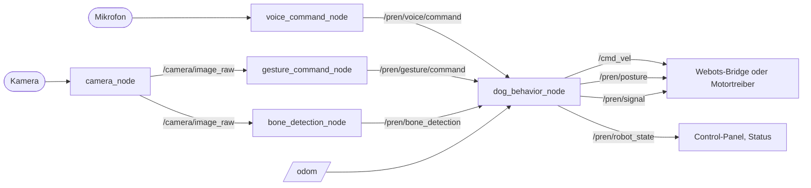

# Umsetzungsplan: Prototypen in ROS-2-Struktur überführen

Stand: 13.11.2026 · Branch `claude/project-thread-ahlzld` · Status: **Entwurf, wartet auf Freigabe**

## 1. Ausgangslage

| Bereich | Heute | Problem |
| --- | --- | --- |
| Sprache | `prototypes/voice_detection/voice_control.py` (921 Zeilen: Vosk, Audio, GUI, UDP in einer Datei), eigenes venv (Python 3.11) | Kein ROS-Node, Logik nicht ohne Mikrofon testbar |
| Gesten | `prototypes/gesture_recognition/` (Klassifikator sauber getrennt, mit Tests), eigenes venv | Kamera, MediaPipe und UDP in einem Prozess, Kamera nicht teilbar |
| Kopplung | UDP 9876 (Befehle), 9878/9879 (Zustand zurück) | Zweiter Kommunikationsweg neben ROS, schwer zu testen und zu debuggen |
| Steuerung | `pren_control/such_driver.py`: Befehlsauswertung, SUCH-Sperre, Such-FSM, UDP-Server, Zustands-Broadcast in einer Klasse | Logik hängt an `rclpy`, keine Unit-Tests, HIER/SITZ/PLATZ/AUF/BRAV nur Text |
| Wahrnehmung Knochen | Webots-Bridge berechnet Sichtkegel aus Ground Truth | Kein Kamera-Pfad, `pren_perception` leer |
| Schnittstellen | Nur `std_msgs/String` (Befehle als freier Text, Zustand als JSON-String) | Tippfehler werden erst zur Laufzeit sichtbar |
| Tests | Nur ament-Linter-Tests in den Paketen | Keine Funktionstests |

## 2. Zielbild

Grundsätze:

1. **Ein Node, eine Aufgabe.** Sensor lesen, erkennen, entscheiden und ausführen sind getrennte Nodes.
2. **Logik ohne ROS.** Jede Erkennungs- und Entscheidungslogik liegt in einer reinen Python-Klasse. Der Node ist nur eine dünne Hülle (Parameter lesen, Topics verbinden). So ist die Logik mit `pytest` ohne Mikrofon, Kamera oder laufendes ROS testbar.
3. **Typisierte Schnittstellen.** Eigene Messages in `pren_interfaces` statt Strings und JSON.
4. **Konfiguration in YAML.** Schwellwerte, Geschwindigkeiten und Gerätenummern in `pren_bringup/config/*.yaml`, nicht im Code.
5. **Gleiche Topics in Simulation und auf dem Pi.** Nur der unterste Layer (Webots-Bridge oder Motortreiber/Kamera) wird ausgetauscht.
6. **Prototypen bleiben unverändert** unter `prototypes/` liegen, solange die Testskripte für MS3 sie brauchen. Löschen nur nach Rückfrage.

### 2.1 Pakete

```
workspace/src/
├── pren_interfaces/        (ament_cmake) Messages
├── pren_perception/        (ament_python) Kamera, Sprache, Gesten, Knochen
├── pren_behavior/          (ament_python) Verhalten des Hundes (FSM)  ← ersetzt such_driver
├── pren_simulation/        (ament_python) Webots-Bridge als Paket
├── pren_control/           bleibt vorerst (circle_driver, reset_gui), wird später aufgeräumt
└── pren_bringup/           Launch-Dateien und YAML-Konfiguration
```

### 2.2 Nodes und Topics



| Node | Paket | Eingang | Ausgang | Reine Logik (testbar) |
| --- | --- | --- | --- | --- |
| `voice_command_node` | pren_perception | Mikrofon (sounddevice/PyAudio) | `/pren/voice/command` | `KeywordSpotter` (Vosk-Text → Befehl, Rauschschwelle, Doppel-Unterdrückung) |
| `camera_node` | pren_perception | Laptop-Kamera (OpenCV) bzw. Pi Camera 3 (Picamera2) | `/camera/image_raw` | – |
| `gesture_command_node` | pren_perception | `/camera/image_raw` | `/pren/gesture/command` | `GestureClassifier`, `GestureSmoother` (aus Prototyp übernommen) |
| `bone_detection_node` | pren_perception | `/camera/image_raw` | `/pren/bone_detection` | `BoneDetector` (YOLO, sobald Modell da ist) |
| `dog_behavior_node` | pren_behavior | Befehle, `/odom`, `/pren/bone_detection` | `/cmd_vel`, `/pren/posture`, `/pren/signal`, `/pren/robot_state` | `DogStateMachine`, `SearchController` |
| `webots_bridge` | pren_simulation | `/cmd_vel`, `/pren/posture`, `/pren/signal`, `/pren/reset` | `/odom`, `/pren/bone_detection` (simuliert) | `DifferentialDrive`, `VisionCone` |

### 2.3 Messages (`pren_interfaces`)

```
# DogCommand.msg  – ein erkannter Befehl
uint8 HIER=1
uint8 BRAV=2
uint8 SITZ=3
uint8 SUCH=4
uint8 PLATZ=5
uint8 AUF=6
std_msgs/Header header
uint8 command
string source          # "voice" | "gesture" | "gui"
float32 confidence

# BoneDetection.msg
std_msgs/Header header
bool detected
float32 distance_m
float32 bearing_rad
float32 confidence

# RobotState.msg
std_msgs/Header header
string state           # IDLE, SITTING, LYING, STANDING, COMING, PRAISED, SEARCHING, ...
bool busy              # true = SUCH läuft, andere Befehle gesperrt
uint8 last_command
string last_command_source

# Posture.msg  (SITZ/PLATZ/AUF für Beine bzw. Anzeige in der Simulation)
uint8 STAND=0
uint8 SIT=1
uint8 LIE=2
uint8 posture

# Signal.msg  (Bellen, Freude, Mission beendet)
uint8 BARK=1
uint8 PRAISE=2
uint8 MISSION_COMPLETE=3
uint8 signal
```

Reset bleibt `std_msgs/Empty` auf `/pren/reset`.

### 2.4 Verhalten (`DogStateMachine`)

| Befehl | Quelle laut Aufgabe | Reaktion |
| --- | --- | --- |
| HIER | Sprache | Kurze Fahrt auf die Person zu (Richtung Schiedsrichter), dann stehen |
| BRAV | Sprache | Signal PRAISE (Ton/Licht), Zustand bleibt |
| SITZ | Sprache und Geste | Stopp, Posture SIT |
| SUCH | Sprache | Such-Ablauf wie heute (Drehen, Sektor absuchen, Anfahren, Bellen, Rückkehr); alle anderen Befehle gesperrt bis fertig |
| PLATZ | Geste | Stopp, Posture LIE |
| AUF | Geste | Posture STAND |

Befehle aus einer nicht erlaubten Quelle (z. B. PLATZ per Sprache) werden geloggt und ignoriert, abschaltbar per Parameter.

## 3. Schritte

Jeder Schritt endet mit grünen Tests und einem eigenen Commit. Nach jedem Schritt läuft die Simulation weiterhin.

| # | Schritt | Ergebnis | Tests |
| --- | --- | --- | --- |
| 0 | **Abhängigkeiten prüfen**: vosk, mediapipe, sounddevice in die Pixi-Umgebung (Python 3.12) aufnehmen; pixi-Tasks `build`, `test`, `sim` anlegen | Ein Python-Env für alles; `pixi run test` läuft | Import-Smoke-Test |
| 1 | **`pren_interfaces`** mit den Messages oben | `ros2 interface show pren_interfaces/msg/DogCommand` funktioniert | Build |
| 2 | **`pren_behavior`**: `DogStateMachine` + `SearchController` aus `such_driver.py` herauslösen, `dog_behavior_node` als Hülle | SUCH-Ablauf identisch zu heute, plus echte Reaktion auf HIER/SITZ/PLATZ/AUF/BRAV | Unit-Tests für jeden Befehl, SUCH-Sperre, Reset, Quellen-Filter; Regler-Tests für Drehen/Rückfahrt |
| 3 | **`pren_simulation`**: Webots-Bridge auf neue Topics umstellen, Posture und Signal anzeigen (Text/Farbe/Ton), Sichtkegel-Berechnung als testbare Funktion | Simulation zeigt alle 6 Befehle sichtbar | Unit-Tests für Kinematik und Sichtkegel |
| 4 | **`voice_command_node`**: `KeywordSpotter` aus `voice_control.py` übernehmen, Audio-Eingang separat | Sprache direkt als ROS-Node, kein UDP | Unit-Tests mit festen Vosk-Texten (Doppel, Rauschen, Nicht-Befehle); optional WAV-Dateien |
| 5 | **`camera_node` + `gesture_command_node`**: Klassifikator und Glättung übernehmen, bestehende Tests mitnehmen | Gesten als ROS-Node; Kamera einmal geöffnet, mehrfach genutzt | Bestehende 9 Tests + Node-Test mit Testbild |
| 6 | **`pren_bringup`**: `simulation.launch.py` (Webots + alle Nodes), `perception.launch.py` (nur Laptop-Kamera/-Mikro, für T1/T2), YAML-Konfiguration; Startskripte anpassen | Ein Befehl startet alles; Prototyp-Start per Argument `use_prototypes:=true` weiterhin möglich | launch_testing: Befehl rein → Zustand raus |
| 7 | **`bone_detection_node`** (Gerüst): Node + Schnittstelle, Erkennung austauschbar; YOLO-Modell einhängen, sobald trainiert | Kamera-Pfad bereit für T3 | Test mit Platzhalter-Detektor und Testbild |
| 8 | **Doku und Aufräumen**: `INTERFACES.md`, `README.md`, Simulations-Guide aktualisieren; UDP-Pfad und `such_driver` als veraltet markieren (nicht löschen) | Doku entspricht dem Code | – |

Reihenfolge-Begründung: Schritt 2 bringt den grössten Gewinn (Verhalten testbar, alle Befehle sichtbar) und hängt nicht von Mikrofon/Kamera ab. Sprache und Gesten folgen, wenn Steuerung und Simulation auf den neuen Topics laufen.

## 4. Risiken und offene Punkte

1. **Python-Versionen.** ROS (Pixi) nutzt Python 3.12, die Prototypen 3.11. Vosk hat Wheels für 3.12. Bei MediaPipe ist zu prüfen, ob die Version zur NumPy-2-Installation von RoboStack passt. Fallback: Gesten-Erkennung läuft weiter im eigenen venv und ein kleiner `udp_command_bridge_node` übersetzt UDP sauber in `/pren/gesture/command` (Adapter, keine Logik).
2. **Message-Build unter Windows** braucht die Visual Studio Build Tools (sind installiert, Build wird in Schritt 1 geprüft).
3. **MS3 am 04.12.** Die Testskripte T1/T2 nutzen den Prototyp-Code. Sie bleiben lauffähig; Umstellung auf die Nodes erst, wenn die Nodes gleichwertig getestet sind.
4. **HIER in der Simulation**: Wie weit fährt der Hund auf die Person zu? Vorschlag: 0.5 m Richtung Schiedsrichter, dann stehen (Parameter).
5. **Lokale, nicht committete Änderungen** (BRAV in `voice_control.py`, `such_driver.py`, Testskripte) liegen im Arbeitsverzeichnis. Ich committe sie nicht ungefragt.
6. **Pi Camera 3** braucht auf dem Pi `picamera2`; `camera_node` bekommt dafür ein austauschbares Backend (OpenCV am Laptop, Picamera2 am Pi).
