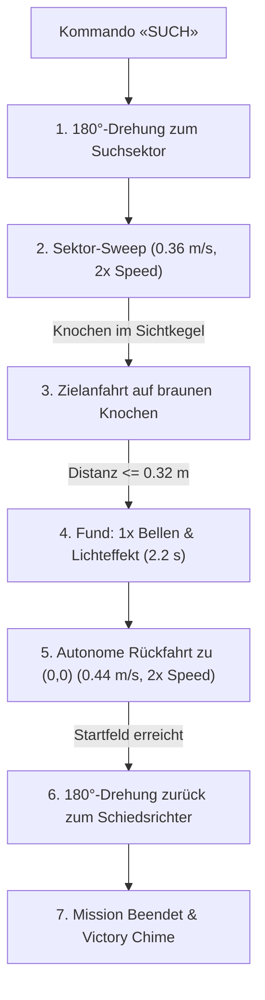

# PREN Simulation Setup & User Guide

Dieses Dokument führt Schritt für Schritt durch die Installation, Konfiguration und Ausführung der vollständigen **PREN-Simulation (Roboterhund Gruppe 17)** unter Windows 11.

---

## Inhaltsverzeichnis

1. [Systemvoraussetzungen](#1-systemvoraussetzungen)
2. [Einmalige Installation & Vorbereitung](#2-einmalige-installation--vorbereitung)
3. [Simulation starten (Schnellstart)](#3-simulation-starten-schnellstart)
4. [Ablauf, Befehle & Suchmission](#4-ablauf-befehle--suchmission)
5. [Simulator Control Panel & Reset-Funktionen](#5-simulator-control-panel--reset-funktionen)
6. [Architektur & Schnittstellen](#6-architektur--schnittstellen)
7. [Fehlerbehebung (Troubleshooting)](#7-fehlerbehebung-troubleshooting)

---

## 1. Systemvoraussetzungen

* **Betriebssystem:** Windows 11 (64-Bit)
* **Paketmanager:** [Pixi](https://pixi.sh/) (Version 0.79 oder neuer)
* **Robotik-Simulator:** [Webots R2025a](https://cyberbotics.com/)
  * Standard-Installationspfad: `%LOCALAPPDATA%\Programs\Webots` oder `C:\Program Files\Webots`
* **Python für Standalone-Prototypen:** Python 3.11 (64-Bit)
  * Wird für die Prototypen `prototypes/voice_detection` und `prototypes/gesture_recognition` benötigt.
* **Hardware:**
  * Mikrofon (für die Vosk-Sprachsteuerung)
  * Webcam (für die MediaPipe-Gestenerkennung)

---

## 2. Einmalige Installation & Vorbereitung

Öffnen Sie ein PowerShell- oder Eingabeaufforderungs-Terminal im Hauptverzeichnis des Projekts (`Roboterhund-Gruppe17`):

### Schritt 2.1: Pixi- und ROS-2-Umgebung einrichten

```powershell
# Pixi-Abhängigkeiten installieren (ROS 2 Jazzy, Cyclone DDS, Colcon)
pixi install

# Prüfen, ob ROS 2 bereit ist
pixi run ros2 --help
```

### Schritt 2.2: ROS-2-Workspace bauen

```powershell
cd workspace
pixi run colcon build --merge-install
cd ..
```

### Schritt 2.3: Python-3.11-Umgebungen für Sprach- und Gestenerkennung anlegen

Die Prototypen für Sprach- und Gestenerkennung laufen in isolierten Python 3.11 Virtual Environments, um Versionskonflikte mit der ROS-2-Conda-Umgebung (Python 3.12) auszuschliessen.

```powershell
# 1. Virtual Environment für Spracherkennung erstellen & Abhängigkeiten installieren:
py -3.11 -m venv prototypes\voice_detection\.venv
prototypes\voice_detection\.venv\Scripts\pip install -r prototypes\voice_detection\requirements.txt

# 2. Virtual Environment für Gestenerkennung erstellen & Abhängigkeiten installieren:
py -3.11 -m venv prototypes\gesture_recognition\.venv
prototypes\gesture_recognition\.venv\Scripts\pip install -r prototypes\gesture_recognition\requirements.txt
```

> **Hinweis zu KI-Modellen:**
> * Das deutsche Vosk-Akustikmodell (`vosk-model-small-de-0.15`, ca. 45 MB) wird beim ersten Start automatisch nach `prototypes/voice_detection/models/` heruntergeladen.
> * Das MediaPipe-Handmodell (`hand_landmarker.task`, ca. 8 MB) wird ebenfalls automatisch nach `prototypes/gesture_recognition/` geladen.

---

## 3. Simulation starten (Schnellstart)

### Der 1-Klick-Start (Empfohlen)

Doppelklicken Sie im Projektverzeichnis auf:
👉 **`scripts\start_simulation.bat`**
*(oder in PowerShell: `.\scripts\start_simulation.ps1`)*

Dieses Skript führt automatisch folgende Schritte aus:
1. Überprüft die Pfade zu Pixi und Webots.
2. Baut den ROS-2-Workspace mit `colcon build --merge-install`.
3. Startet Webots mit der Welt [`pren_simulation.wbt`](file:///c:/Users/Oliver/Documents/Roboterhund-Gruppe17/simulation/webots/worlds/pren_simulation.wbt).
4. Verbindet die externe Roboterbrücke [`webots_bridge.py`](file:///c:/Users/Oliver/Documents/Roboterhund-Gruppe17/simulation/webots/controllers/webots_bridge/webots_bridge.py) über Port 1234.
5. Richtet die Webots-Kamera automatisch zentriert über dem Startfeld mit Blick in den Suchsektor aus.
6. Startet den autonomen FSM-Suchknoten [`such_driver.py`](file:///c:/Users/Oliver/Documents/Roboterhund-Gruppe17/workspace/src/pren_control/pren_control/such_driver.py) im Ruhezustand (IDLE).
7. Öffnet das **Simulator Control Panel** ([`reset_button_gui.py`](file:///c:/Users/Oliver/Documents/Roboterhund-Gruppe17/workspace/src/pren_control/pren_control/reset_button_gui.py)).
8. Startet parallel das Dashboard der **Spracherkennung** ([`voice_control.py`](file:///c:/Users/Oliver/Documents/Roboterhund-Gruppe17/prototypes/voice_detection/voice_control.py)).
9. Startet parallel das Fenster der **Gestenerkennung** ([`gesture_control.py`](file:///c:/Users/Oliver/Documents/Roboterhund-Gruppe17/prototypes/gesture_recognition/gesture_control.py)).

### Alternativ: Manueller Start über ROS-2-Launch

```powershell
pixi run cmd /c "cd workspace && call .\install\local_setup.bat && ros2 launch pren_bringup simulation.launch.py"
```

Optionale Launch-Argumente:
```powershell
# Ohne Gestenerkennung starten (z. B. wenn keine Webcam vorhanden ist):
ros2 launch pren_bringup simulation.launch.py launch_gesture:=false

# Ohne Spracherkennung starten (z. B. wenn kein Mikrofon vorhanden ist):
ros2 launch pren_bringup simulation.launch.py launch_voice:=false
```

---

## 4. Ablauf, Befehle & Suchmission

### Ausgangssituation
* Der Roboter (Pioneer 3-DX) startet auf der grünen Markierung im Startfeld bei $(0, 0)$.
* Er ist um **180 Grad abgewandt** vom Suchbereich ausgerichtet (`rotation 0 0 1 3.14159`) und blickt direkt zum Interaktionsbereich (Schiedsrichter).
* Der Knochen (brauner Zylinder) wird bei jedem Start zufällig an eine neue Position im $30^\circ$-Suchsektor platziert.

### Befehle im Ruhezustand (IDLE)
Solange die Suche noch nicht gestartet wurde, nimmt der Roboter folgende Sprach- und Gestenbefehle entgegen:

| Befehl | Quelle | Bedeutung |
| :--- | :--- | :--- |
| **«SITZ»** | Sprache oder Geste (Offene Handfläche) | Roboter nimmt Sitz-Haltung ein |
| **«PLATZ»** | Sprache oder Geste (Zeigefinger nach unten) | Roboter legt sich ab |
| **«AUF»** | Sprache oder Geste (Zeigefinger nach oben) | Roboter steht auf und ist bereit |
| **«HIER»** | Sprache | Roboter richtet Aufmerksamkeit auf Schiedsrichter |
| **«SUCH»** | Sprache | **Startet die autonome Suchmission!** |

### Der Suchablauf («Such»)
Sobald das Schlüsselwort **«Such»** über das Mikrofon erkannt wird:



> **Wichtig – Befehlssperre während der Suche:**
> Während der Roboter die Suchmission ausführt (Schritte 1 bis 6), sind alle weiteren Sprach- und Gestenbefehle **gesperrt**. Der Roboter lässt sich nicht durch Zwischenrufe ablenken. Erst nach vollständiger Rückkehr ins Startfeld und $180^\circ$-Drehung zum Schiedsrichter ist die Sperre wieder aufgehoben.

---

## 5. Simulator Control Panel & Reset-Funktionen

Während der Simulation läuft im Vordergrund das kompakte **Simulator Control Panel**:

* **Live-Statusanzeige:**
  * **Phase:** Aktueller FSM-Zustand des Such-Treibers
  * **Position:** $X$- und $Y$-Koordinaten des Roboters in Metern
  * **Sichtkegel:** Ob der Knochen aktuell im virtuellen $45^\circ$-Sichtkegel erfasst ist
  * **Letzter Befehl:** Zuletzt über Sprache oder Geste empfangenes Kommando
* **Button «🔄 Setup Neustarten / Reset»:**
  * Setzt den Roboter sofort auf $(0, 0)$ zurück (wieder um $180^\circ$ gedreht).
  * Würfelt eine neue zufällige Knochenposition im $30^\circ$-Sektor aus.
  * Schaltet Audio und Lichteffekte sofort ab.
  * Zentriert die Webots-Kamera wieder über dem Startfeld.
  * Setzt den Status auf IDLE zurück (wartet auf neue Befehle).

### Weitere Reset-Möglichkeiten
* **Tastatur-Reset:** Drücken Sie die Taste **`R`** direkt im 3D-Fenster von Webots.
* **Skript:** Doppelklicken Sie auf [`scripts\reset_simulation.bat`](file:///c:/Users/Oliver/Documents/Roboterhund-Gruppe17/scripts/reset_simulation.bat).
* **Terminal:** `pixi run ros2 topic pub --once /pren/reset std_msgs/msg/Empty "{}"`

---

## 6. Architektur & Schnittstellen

### Verzeichnisstruktur
```text
Roboterhund-Gruppe17/
├── prototypes/
│   ├── voice_detection/         # Vosk Offline German Speech Engine
│   │   ├── voice_control.py     # Sprachsteuerung GUI & UDP-Sender
│   │   └── requirements.txt
│   └── gesture_recognition/     # MediaPipe 3D Hand Tracking
│       ├── gesture_control.py   # Gestensteuerung GUI & UDP-Sender
│       └── requirements.txt
├── simulation/
│   └── webots/
│       ├── controllers/
│       │   └── webots_bridge/   # Supervisor Bridge zwischen Webots & ROS 2
│       ├── sounds/              # Audio-Dateien (Bellen, Chime)
│       └── worlds/
│           └── pren_simulation.wbt  # Webots 3D-Welt
├── workspace/
│   └── src/
│       ├── pren_bringup/        # Launchfiles (simulation.launch.py)
│       └── pren_control/        # FSM-Treiber (such_driver.py, reset_gui.py)
└── scripts/
    ├── start_simulation.bat     # 1-Klick Start (Batch)
    ├── start_simulation.ps1     # 1-Klick Start (PowerShell)
    └── reset_simulation.bat     # Schneller Reset
```

### Wichtigste ROS-2-Topics

| Topic | Typ | Richtung | Beschreibung |
| :--- | :--- | :--- | :--- |
| `/pren/command` | `std_msgs/msg/String` | Extern $\rightarrow$ ROS | Steuerbefehl («SUCH», «SITZ», «PLATZ», etc.) |
| `/cmd_vel` | `geometry_msgs/msg/Twist` | Driver $\rightarrow$ Bridge | Geschwindigkeitsbefehle für den Pioneer |
| `/odom` | `nav_msgs/msg/Odometry` | Bridge $\rightarrow$ Driver | Roboterposition und Orientierung (Yaw) |
| `/pren/bone_detection` | `geometry_msgs/msg/PointStamped` | Bridge $\rightarrow$ Driver | Knochenabstand ($X$), Peilwinkel ($Y$), Flag ($Z$) |
| `/pren/search_status` | `std_msgs/msg/String` | Driver $\rightarrow$ GUI | Aktueller Zustand der Zustandsmaschine |
| `/pren/reset` | `std_msgs/msg/Empty` | GUI $\rightarrow$ Bridge/Driver | Löst sofortigen Reset aus |

Weitere Schnittstellen- und Hardware-Details finden sich in [`docs/INTERFACES.md`](file:///c:/Users/Oliver/Documents/Roboterhund-Gruppe17/docs/INTERFACES.md).

---

## 7. Fehlerbehebung (Troubleshooting)

### Problem: `ImportError: DLL load failed` oder `_multiarray_umath` in NumPy
* **Ursache:** Vermischung von Python 3.12 (Pixi) mit den Python 3.11 Virtual Environments über die `PYTHONPATH`-Variable.
* **Lösung:** In `simulation.launch.py` ist das Flag `-E` bereits integriert. Falls Sie einen Prototyp manuell im Terminal starten, bereinigen Sie vorher die Umgebung:
  ```powershell
  $env:PYTHONPATH = ""
  $env:PYTHONHOME = ""
  prototypes\voice_detection\.venv\Scripts\python.exe prototypes\voice_detection\voice_control.py
  ```

### Problem: `Connection failed on port 1234` in Webots
* **Ursache:** Eine frühere Webots-Instanz läuft noch im Hintergrund und belegt Port 1234.
* **Lösung:** Schliessen Sie Webots oder beenden Sie hängende Prozesse im Task-Manager:
  ```powershell
  Stop-Process -Name "webots", "webots-bin" -Force -ErrorAction SilentlyContinue
  ```

### Problem: Webcam oder Mikrofon wird nicht erkannt
* **Kamera:** Überprüfen Sie in Windows unter *Einstellungen > Datenschutz & Sicherheit > Kamera*, ob Desktop-Apps Zugriff auf die Kamera haben. Passen Sie bei Bedarf `--camera-id 1` an.
* **Mikrofon:** Führen Sie `prototypes\voice_detection\.venv\Scripts\python.exe prototypes\voice_detection\voice_control.py --list-devices` aus, um die verfügbaren Audio-Eingänge anzuzeigen.

### Problem: Kamera in Webots ist dezentriert
* Drücken Sie im Simulator Control Panel auf **«🔄 Setup Neustarten / Reset»**; der Controller setzt die Kamera automatisch wieder auf die Idealposition über der Plattform zurück.
