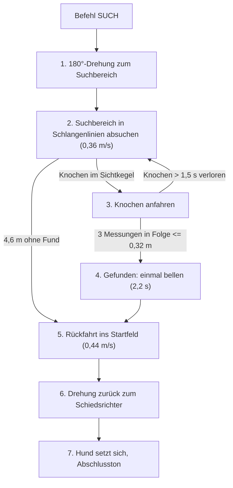

# PREN Simulation Setup & User Guide

Dieses Dokument führt durch Installation und Betrieb der **PREN-Simulation (Roboterhund Gruppe 17)** unter Windows 11. Aufbau, Topics und Verhalten der ROS-2-Nodes stehen in [docs/ARCHITEKTUR.md](../docs/ARCHITEKTUR.md).

---

## Inhaltsverzeichnis

1. [Systemvoraussetzungen](#1-systemvoraussetzungen)
2. [Einmalige Installation](#2-einmalige-installation)
3. [Simulation starten](#3-simulation-starten)
4. [Ablauf, Befehle & Suchmission](#4-ablauf-befehle--suchmission)
5. [Bedienfenster & Reset](#5-bedienfenster--reset)
6. [Aufbau & Schnittstellen](#6-aufbau--schnittstellen)
7. [Fehlerbehebung](#7-fehlerbehebung)

---

## 1. Systemvoraussetzungen

* **Betriebssystem:** Windows 11 (64-Bit)
* **Paketmanager:** [Pixi](https://pixi.sh/). Pixi installiert ROS 2 Jazzy, Vosk, MediaPipe und sounddevice in einer gemeinsamen Umgebung.
* **Robotik-Simulator:** [Webots R2025a](https://cyberbotics.com/)
  * Standard-Installationspfad: `%LOCALAPPDATA%\Programs\Webots` oder `C:\Program Files\Webots`
* **Hardware (optional):** Mikrofon für die Sprachbefehle, Webcam für die Gesten. Ohne beides lässt sich alles über das Bedienfenster steuern.

---

## 2. Einmalige Installation

Im Hauptverzeichnis des Projekts (`Roboterhund-Gruppe17`):

```powershell
# Pixi-Umgebung installieren (ROS 2 Jazzy, Cyclone DDS, Colcon, Vosk, MediaPipe)
pixi install

# ROS-2-Workspace bauen und testen
pixi run build
pixi run test
```

> **Modelle (einmalig herunterladen):** Das Vosk-Modell `vosk-model-small-de-0.15` gehört nach `models/voice/`, das MediaPipe-Handmodell `hand_landmarker.task` nach `models/gesture/`. Download-Links: [models/voice/README.md](../models/voice/README.md) und [models/gesture/README.md](../models/gesture/README.md). Ohne Modelle startet die Simulation mit `voice:=false gesture:=false`.

---

## 3. Simulation starten

### 1-Klick-Start (empfohlen)

Doppelklick auf 👉 **`scripts\start_simulation.bat`** (oder in PowerShell `.\scripts\start_simulation.ps1`).

Das Skript
1. prüft die Pfade zu Pixi und Webots,
2. baut den ROS-2-Workspace mit `colcon build --merge-install`,
3. startet `ros2 launch pren_bringup simulation.launch.py`. Diese Launch-Datei startet:
   * Webots mit der Welt `simulation/webots/worlds/pren_simulation.wbt`,
   * die Webots-Bridge (`simulation/webots/controllers/pren_bridge/pren_bridge.py`, Logik im Paket `pren_simulation`) über Port 1234,
   * `dog_behavior` (Zustandsautomat, Paket `pren_behavior`),
   * das Bedienfenster `control_panel`,
   * die Wahrnehmung: `camera`, `gesture_command` und `voice_command` (Paket `pren_perception`).

### Manueller Start und Optionen

```powershell
pixi run cmd /c "cd workspace && call .\install\local_setup.bat && ros2 launch pren_bringup simulation.launch.py"
```

Launch-Argumente:
```powershell
# Ohne Kamera und Gestenerkennung (z. B. ohne Webcam):
ros2 launch pren_bringup simulation.launch.py gesture:=false

# Ohne Spracherkennung (z. B. ohne Mikrofon):
ros2 launch pren_bringup simulation.launch.py voice:=false

# Ohne Bedienfenster:
ros2 launch pren_bringup simulation.launch.py control_panel:=false

# Für automatische Tests: Webots minimiert, ohne Darstellung, eigener Port
ros2 launch pren_bringup simulation.launch.py webots_gui:=false webots_port:=1240
```

### Automatischer Abnahmetest

Bei laufender Simulation spielt `simulation_check` alle Befehle ein und prüft die Reaktion (Haltung, Lob, HIER, SUCH mit Rückkehr, Befehlssperre während SUCH):

```powershell
pixi run cmd /c "cd workspace && call .\install\local_setup.bat && ros2 run pren_simulation simulation_check --ros-args -p search_runs:=5"
```

Exit-Code 0 bedeutet: alles bestanden.

---

## 4. Ablauf, Befehle & Suchmission

### Ausgangssituation
* Der Roboter (Pioneer 3-DX) startet im Startfeld bei $(0, 0)$, um 180 Grad vom Suchbereich abgewandt, mit Blick zum Schiedsrichter.
* Der Knochen wird bei jedem Start und Reset zufällig im Suchsektor platziert.
* Die Knochenerkennung ist in der Simulation ein Sichtkegel von ±22,5° und 3 m Reichweite, berechnet aus den Positionen in Webots.

### Befehle

| Befehl | Quelle laut Aufgabe | Reaktion |
| :--- | :--- | :--- |
| **SITZ** | Sprache oder Geste (offene Hand, aufrecht) | Haltung SITZ, Hund steht still |
| **PLATZ** | Geste (Zeigefinger nach unten) | Haltung PLATZ |
| **AUF** | Geste (Zeigefinger nach oben) | Haltung STEHEN |
| **HIER** | Sprache | Fährt 0,5 m auf die Person zu |
| **BRAV** | Sprache | Lob-Signal, Zustand bleibt |
| **SUCH** | Sprache | Startet die Suchmission |

Befehle aus einer nicht erlaubten Quelle (z. B. PLATZ per Sprache) werden ignoriert. Das Bedienfenster darf zum Testen alle Befehle senden. Haltung und Lob zeigt die Simulation als Text im 3D-Fenster an.

### Suchablauf (SUCH)



> **Befehlssperre während der Suche:** Solange SUCH läuft, werden alle anderen Befehle ignoriert. Am Ende sitzt der Hund im Startfeld mit Blick zum Schiedsrichter und spielt den Abschlusston (Anforderung 5.8). Danach nimmt er wieder Befehle an, z. B. AUF zum Aufstehen. Die Werte stehen in `workspace/src/pren_bringup/config/behavior.yaml`.

---

## 5. Bedienfenster & Reset

Das **Bedienfenster** (`control_panel`, Paket `pren_simulation`):
* hat Knöpfe für alle sechs Befehle (Quelle `gui`), damit sich das Verhalten auch ohne Mikrofon und Kamera testen lässt,
* zeigt Zustand und Tätigkeit des Hundes, den letzten Befehl mit Quelle, die Position und die Knochenerkennung,
* hat einen **Reset**-Knopf. Er setzt den Roboter ins Startfeld zurück, platziert den Knochen neu, stoppt Ton und Licht, zentriert die Kamera und bricht jede laufende Aufgabe ab.

### Weitere Reset-Möglichkeiten
* **Tastatur:** Taste **`R`** im 3D-Fenster von Webots.
* **Skript:** Doppelklick auf `scripts\reset_simulation.bat`.
* **Terminal:** `ros2 topic pub --once /pren/reset std_msgs/msg/Empty "{}"`

---

## 6. Aufbau & Schnittstellen

### Verzeichnisstruktur
```text
Roboterhund-Gruppe17/
├── simulation/
│   └── webots/
│       ├── controllers/
│       │   └── pren_bridge/     # Startet die Bridge aus pren_simulation
│       ├── sounds/              # Bellen, Abschluss-Ton
│       └── worlds/
│           └── pren_simulation.wbt
├── workspace/src/
│   ├── pren_interfaces/         # Messages
│   ├── pren_perception/         # Kamera, Sprache, Gesten, Knochen
│   ├── pren_behavior/           # Zustandsautomat, SUCH, HIER
│   ├── pren_simulation/         # Webots-Bridge, Bedienfenster, simulation_check
│   └── pren_bringup/            # Launch-Dateien, config/*.yaml
├── testnachweis/                # Tests T1–T3a am Laptop
└── scripts/
    ├── start_simulation.bat / .ps1
    └── reset_simulation.bat / .ps1
```

### Wichtigste ROS-2-Topics

| Topic | Typ | Von → An |
| :--- | :--- | :--- |
| `/pren/dog_command` | `pren_interfaces/DogCommand` | Sprache, Gesten, Bedienfenster → `dog_behavior` |
| `/cmd_vel` | `geometry_msgs/Twist` | `dog_behavior` → Bridge |
| `/pren/posture` | `pren_interfaces/Posture` | `dog_behavior` → Bridge |
| `/pren/dog_signal` | `pren_interfaces/DogSignal` | `dog_behavior` → Bridge (Bellen, Lob, Abschluss) |
| `/pren/robot_state` | `pren_interfaces/RobotState` | `dog_behavior` → Bridge, Bedienfenster |
| `/odom` | `nav_msgs/Odometry` | Bridge → `dog_behavior`, Bedienfenster |
| `/pren/bone_detection` | `pren_interfaces/BoneDetection` | Bridge (simulierter Sichtkegel) → `dog_behavior` |
| `/pren/reset` | `std_msgs/Empty` | Bedienfenster, Skript → `dog_behavior`, Bridge |

Alle Topics, Parameter und Zustände: [docs/ARCHITEKTUR.md](../docs/ARCHITEKTUR.md).

---

## 7. Fehlerbehebung

### Webots stürzt beim Start ab (0xC0000374)
* **Ursache:** Webots lädt Qt-Plugins aus der Pixi-Umgebung.
* **Lösung:** `simulation.launch.py` startet Webots bereits ohne Pixi-Umgebung. Webots nicht selbst aus einer `pixi shell` heraus starten.

### `Connection failed on port 1234` in Webots
* **Ursache:** Eine frühere Webots-Instanz läuft noch und belegt Port 1234.
* **Lösung:** Webots schliessen oder hängende Prozesse beenden:
  ```powershell
  Stop-Process -Name "webots", "webots-bin" -Force -ErrorAction SilentlyContinue
  ```

### Webcam oder Mikrofon wird nicht erkannt
* **Kamera:** In Windows unter *Einstellungen > Datenschutz & Sicherheit > Kamera* den Zugriff für Desktop-Apps erlauben. Eine externe Webcam stellt man in `workspace/src/pren_bringup/config/perception.yaml` mit `camera.device: 1` ein.
* **Mikrofon:** Liste der Eingänge mit `pixi run python -m sounddevice`, dann `voice_command.device` in `perception.yaml` setzen (`-1` = Standardmikrofon).
* Ohne Kamera oder Mikrofon mit `gesture:=false` bzw. `voice:=false` starten.

### Kamera in Webots ist dezentriert
* Reset im Bedienfenster oder Taste `R`: die Kamera wird wieder über dem Startfeld zentriert.
